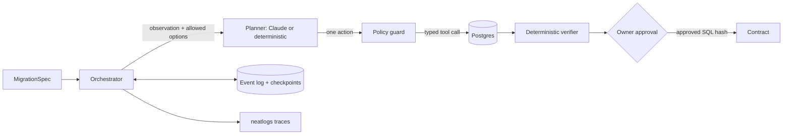

# Migration Parachute

A schema migration can be correct and still take down a service. Migration Parachute is an agent that runs an expand / backfill / contract migration on a live Postgres table. When another session holds the rows it needs, it rolls back the chunk, records who holds the lock, shrinks its batch, waits, and resumes from a saved cursor. It will not prepare the destructive step until a deterministic verifier proves parity, and it will not run that step until an owner approves the exact SQL.

Built for neatHack 2026 (10–12 October 2026). All code in this repository was written during the event.

> The demo runs on a **fictional local fixture**: 2,000 customers and 10,000 orders on local Postgres 15, emails on the reserved `.test` domain. It never touches a real database.

## Results

Same fixture, same seeded fault: a separate session holds row locks on keys 4,001–4,100 for 6 seconds while the backfill reaches them. The per-statement lock budget is 300 ms.

| Run | Outcome | Retries | Lock wait | Rows kept |
|---|---|---:|---:|---:|
| Baseline: one `UPDATE` in one transaction | `FAILED`, whole transaction rolled back | – | 452 ms | 0 |
| Agent with first recovery policy (`naive-retry/v0`: same batch, 50 ms wait) | `PAUSED_LOCK_BUDGET`, retry budget spent | 6 | 2,647 ms | 4,000 |
| Agent with fixed recovery policy (`adaptive/v1`) | parity proven, `CONTRACT_READY` | 4 | 1,817 ms | 10,000 |

| Agent with a language-model planner (DeepSeek V4.1 Flash via OpenRouter, inside the same policy fence) | parity proven, `CONTRACT_READY` | 2 | 751 ms | 10,000 |

Neither failing run claims success. Full replay suite, 12 scenarios: v0 passes 11, v1 passes 12. Both have zero false successes and zero destructive statements run without approval. Raw records: [`evidence/replay-naive-v0.json`](evidence/replay-naive-v0.json) and [`evidence/replay-adaptive-v1.json`](evidence/replay-adaptive-v1.json). Lock-wait figures vary by tens of milliseconds between runs; three repeats of each policy gave the same outcome every time.

The language-model planner passes all 12 scenarios with no rejected decisions: 14 decisions, 9,278 input and 5,239 output tokens, $0.0094 in total ([`evidence/replay-llm-deepseek-v4.1-flash.json`](evidence/replay-llm-deepseek-v4.1-flash.json)). On the lock run it read the blocker's age from the error evidence: after the first timeout it waited 1 s; when the blocking transaction was 4.1 s old it waited 3 s, so it needed two retries where the fixed policy needed four. Each answer must name one of the actions policy allows, inside its bounds; anything else is rejected and recorded, and the deterministic planner answers instead.

The v0 policy was committed and measured before the fix. The git history shows the order: `ed9edbe` (v0, 11/12) then `5e05e92` (fix, 12/12). The records each commit produced at the time are kept in [`evidence/history/`](evidence/history/); they used a 3.0 s lock. The lock is now held for 6 s, because v1's blocker inspection made each failed attempt slower, and at 3.5 s the naive policy sometimes outlasted the lock.

## What the agent does



1. **Inspect** the table and reject a bad spec before any side effect: non-unique key, ambiguous lookup, wrong database, or a column that someone else already owns.
2. **Plan** expand, backfill and contract SQL from a typed change. The planner never writes SQL.
3. **Expand**: add a nullable column and a dual-write trigger, and build the index concurrently. Each step writes an idempotency ledger row in the same transaction.
4. **Backfill** in key-range chunks, one short transaction each, with a lock timeout. On failure, ask the planner for one action from the options policy allows (retry with a batch size and wait inside set bounds, pause, or abort). Anything outside those bounds is rejected and recorded.
5. **Verify** in one consistent snapshot: parity checksum, null targets, mismatches, orphans, pending ranges, index validity. If new rows arrived, run a catch-up pass first.
6. **Guard the contract**: fresh proof, no views or functions still reading the old column, then prepare the SQL and an approval ID bound to the SQL hash and proof hash.
7. **Wait for approval.** Only then add the foreign key, set NOT NULL, drop the trigger and drop the old column, and verify the result.

Every step appends to a hash-chained event log. A pure reducer rebuilds run state from it. Appends use compare-and-swap on the revision and a fencing token, and a Postgres advisory lock allows one worker per run. After a crash, a new worker adopts chunks the database committed but the control store never recorded, by reading the ledger. Nothing is re-run blindly.

## Scenarios

| Scenario | Expected behaviour |
|---|---|
| `clean` | Expand, backfill, verify; stop at the approval gate |
| `clean_approved` | Same, then the owner approves; contract runs and verifies |
| `baseline_lock_timeout` | One-transaction backfill fails under the lock; no success claimed |
| `lock_timeout` | Roll back, record blocker, shrink batch, back off, resume from the same cursor |
| `crash_after_commit` | Worker dies after the database commits a chunk; a new worker adopts it from the ledger |
| `parity_mismatch` | A writer bypasses the trigger; verifier blocks the contract |
| `schema_drift` | Unrelated column added after planning; re-inspect and replan |
| `schema_conflict` | Target column exists with the wrong type; fail before expand |
| `concurrent_inserts` | Rows arrive mid-backfill, some skipping triggers; catch-up pass |
| `invalid_key` | Non-unique chunk key; reject with no side effects |
| `budget` | Cost cap reached; pause with the checkpoint, resume with a higher cap |
| `view_dependency` | A view still reads the old column; contract paused for the operator |

## Run it

Needs Python 3.13 with [uv](https://docs.astral.sh/uv/), and a local Postgres 15 that the current user can create databases on. Fixture databases must be named `parachute*`; the code refuses to reset any other.

```sh
uv sync
uv run parachute replay                     # all scenarios, adaptive planner
uv run parachute replay lock_timeout --planner naive
uv run parachute serve                      # execution UI on http://127.0.0.1:8777
uv run pytest                               # unit and real-Postgres tests
```

Optional keys go in a local `.env` file, which git ignores:

```sh
NEATLOGS_API_KEY=...          # send traces to neatlogs
OPENROUTER_API_KEY=...        # enable --planner llm (default deepseek/deepseek-v4.1-flash)
# or ANTHROPIC_API_KEY=... for claude-opus-5-5, or PARACHUTE_LLM=bedrock AWS_PROFILE=... AWS_REGION=...
```

## Partner tools

- **neatlogs** traces every run as one `WORKFLOW` with nested `AGENT` (planner decisions), `TOOL` (database calls, lock inspection, ledger reconciliation), `GUARDRAIL` (spec validation, drift, contract guard, fail-closed) and `EVALUATOR` (expand, backfill and contract verification) spans. Attributes carry hashes, counts, SQLSTATEs and timings, never row values. The same tree is written locally to `var/traces/` for the UI. The before/after runs were exported to neatlogs; their trace ids are in [`evidence/neatlogs-before-naive-v0.json`](evidence/neatlogs-before-naive-v0.json) and [`evidence/neatlogs-after-adaptive-v1.json`](evidence/neatlogs-after-adaptive-v1.json) (field `neatlogs_trace_ids`). Each process initialises neatlogs once, and every trace of one run shares the run id as its session.
- **Entire** records the coding-agent sessions that built this repository. Each commit carries an `Entire-Checkpoint` trailer; `entire checkpoint explain <id>` shows the prompts and decisions behind it, including the v0-to-v1 recovery fix.
- **cfo.ai** holds the business model: price, runs per customer, the measured cost ledger per run, and three adoption scenarios. See [`docs/cfo-model-inputs.md`](docs/cfo-model-inputs.md), the [independent verification](evidence/cfo/model-verification.md), and the [Migration Parachute business-plan page](https://app.cfo.ai/sher-cfoai-a1e2b615/pages/a8fa343a-4234-4a54-a784-971b110829a8).

## AI tools used

Claude Code (Claude Opus 5.5) wrote most of the code under the author's direction. Entire captured those sessions as checkpoints. Earlier planning used OpenAI Codex. The research and architecture notes were written before kickoff, as the rules allow; they are not part of this repository.

## Limits

- One change kind so far: replace a text column with a foreign key found by lookup.
- Integer primary keys only, because backfill chunks by key range.
- The fixture, faults and evidence are local. No production database has been tested.
- The contract assumes the application has stopped writing the old column; the owner confirms that when approving.

## Layout

```
src/parachute/
  domain.py        typed contracts and events
  state.py         pure reducer
  store.py         SQLite event log, checkpoints, fencing
  pg.py            Postgres adapter with idempotency ledger
  sqlgen.py        SQL generated from the typed change
  orchestrator.py  the agent loop
  policy.py        allowed actions and decision checks
  planners.py      naive-retry/v0 and adaptive/v1
  llm_planner.py   language-model planners (OpenRouter, Claude) inside the policy fence
  verifier.py      deterministic proofs
  faults.py        seeded failures through real connections
  replay.py        scenario suite and evidence records
  api.py, web/     execution UI
evidence/          replay results; history/ keeps what each commit measured
tests/             unit and integration tests
```
